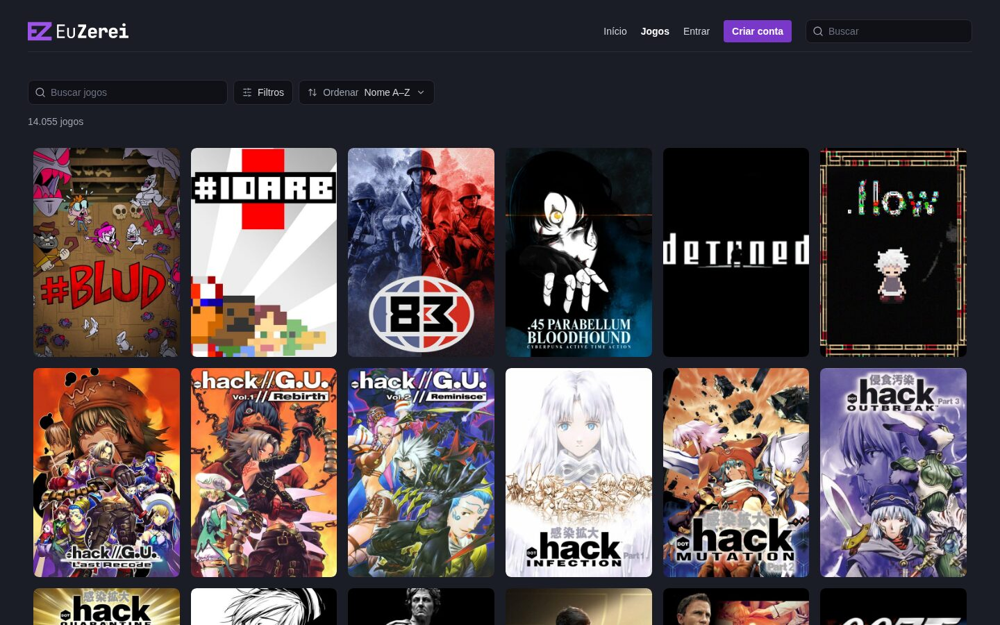

# EuZerei (front-end)

Aplicação web para organizar a sua biblioteca de jogos: cada jogo no status certo, com horas por plataforma, nota e review. Dá para importar a biblioteca da Steam, da PSN e do Xbox.

**Demo:** https://euzereiapp.vercel.app




Este repositório é o front-end. A API fica em [MathQuente/euzerei](https://github.com/MathQuente/euzerei).

## Funcionalidades

- Catálogo de jogos com busca, filtros e ordenação (dados do IGDB)
- Biblioteca pessoal com status: zerado, jogando, na fila e desejo
- Notas e reviews por jogo
- Perfis públicos e biblioteca pública paginada
- Importação da biblioteca da Steam, PSN e Xbox
- Roleta para sortear o próximo jogo
- Login com e-mail, Google e Discord

## Stack

React 18, TypeScript, Vite, Tailwind CSS, React Router 7, TanStack Query 5, react-hook-form + Zod, Radix UI, Embla Carousel. Testes com Vitest e lint/formatação com Biome.

## Organização do código

```
src/
  pages/        uma página por rota (rotas registradas em main.tsx)
  components/   componentes de interface
  hooks/        hooks do TanStack Query e o cliente HTTP (useApi.ts)
  contexts/     autenticação (React Context)
  schemas/      validações com Zod
```

O estado vindo do servidor passa todo pelo TanStack Query. A autenticação usa cookie httpOnly, definido pela API.

## Rodando localmente

Pré-requisitos: Node 22 ou mais novo e a [API](https://github.com/MathQuente/euzerei) rodando em `http://localhost:3333`.

```bash
npm install
npm run dev
```

Em desenvolvimento, o Vite encaminha `/api` para `http://localhost:3333`. A variável opcional `VITE_API_URL` muda o endereço da API usado nos botões de login social.

## Scripts

| Comando | O que faz |
| --- | --- |
| `npm run dev` | servidor de desenvolvimento |
| `npm run build` | checagem de tipos e build de produção |
| `npm test` | testes com Vitest |
| `npm run check` | lint e formatação com Biome |

## Deploy

O front-end roda na Vercel. O `vercel.json` encaminha `/api/*` para a API, hospedada separadamente.

## Documentação

O mapa detalhado do código está em [docs/CODEBASE_MAP.md](docs/CODEBASE_MAP.md).
