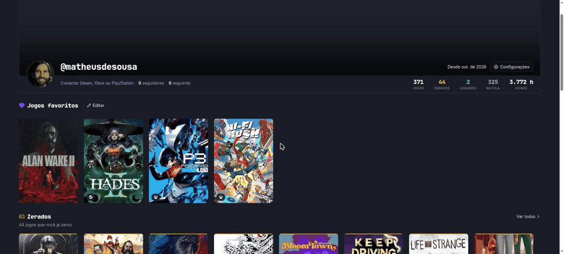

<picture>
  <source media="(prefers-color-scheme: dark)" srcset="docs/logo/euzerei-horizontal-on-dark.svg">
  
</picture>

# EuZerei (front-end)

[](https://github.com/MathQuente/euzerei-front-end/actions/workflows/ci.yml)

Front-end do EuZerei, um rastreador de biblioteca de jogos: cada jogo no status certo, com horas por plataforma, nota e review, e importação da Steam, PSN e Xbox.

**Demo:** https://euzereiapp.vercel.app

Este repositório é o front-end. A API fica em [MathQuente/euzerei](https://github.com/MathQuente/euzerei).

<p align="center">
  
</p>

<table>
  <tr>
    <td width="50%"></td>
    <td width="50%"></td>
  </tr>
  <tr>
    <td align="center"><sub>Página inicial</sub></td>
    <td align="center"><sub>Catálogo com mais de 14 mil jogos</sub></td>
  </tr>
</table>

<details>
  <summary>Ver a busca no catálogo em GIF</summary>
  <br>
  
</details>

## Funcionalidades

- Catálogo de jogos com busca, filtros e ordenação (dados do IGDB)
- Biblioteca pessoal com status: zerado, jogando, na fila e desejo
- Notas e reviews por jogo
- Perfis públicos e biblioteca pública paginada
- Importação da biblioteca da Steam, PSN e Xbox
- Roleta para sortear o próximo jogo
- Login com e-mail, Google e Discord

## Stack

- **Interface:** React 18, TypeScript, Vite, Tailwind CSS, Radix UI, Embla Carousel
- **Rotas:** React Router 7
- **Dados do servidor:** TanStack Query 5, com axios como cliente HTTP
- **Formulários:** react-hook-form + Zod
- **Qualidade:** Vitest nos testes, Biome no lint e na formatação, GitHub Actions no CI
- **Hospedagem:** Vercel

## Estrutura do repositório

- `src/pages/` — uma página por rota (registradas em `main.tsx`)
- `src/components/` — componentes de interface
- `src/hooks/` — hooks do TanStack Query e o cliente HTTP (`useApi.ts`)
- `src/contexts/` — autenticação (React Context)
- `src/schemas/` — validações com Zod
- `public/` — ícones, `og-image.jpg`, `robots.txt` e `sitemap.xml`
- `docs/` — mapa do código, logo e mídia deste README

O estado vindo do servidor passa todo pelo TanStack Query. A autenticação usa cookie httpOnly, definido pela API.

## Documentação

- Mapa detalhado do código, fluxos de dados e armadilhas conhecidas: [`docs/CODEBASE_MAP.md`](docs/CODEBASE_MAP.md)

## Como rodar

Pré-requisitos: Node 22 ou mais novo e a [API](https://github.com/MathQuente/euzerei) rodando em `http://localhost:3333`.

```bash
npm install
npm run dev
```

Em desenvolvimento, o Vite encaminha `/api` para `http://localhost:3333`. A variável opcional `VITE_API_URL` muda o endereço da API usado nos botões de login social.

| Comando | O que faz |
| --- | --- |
| `npm run dev` | servidor de desenvolvimento |
| `npm run build` | checagem de tipos e build de produção |
| `npm test` | testes com Vitest |
| `npm run check` | lint e formatação com Biome |

## Deploy

O front-end roda na Vercel. O `vercel.json` encaminha `/api/*` para a API, hospedada separadamente.

## Licença

[MIT](LICENSE)
