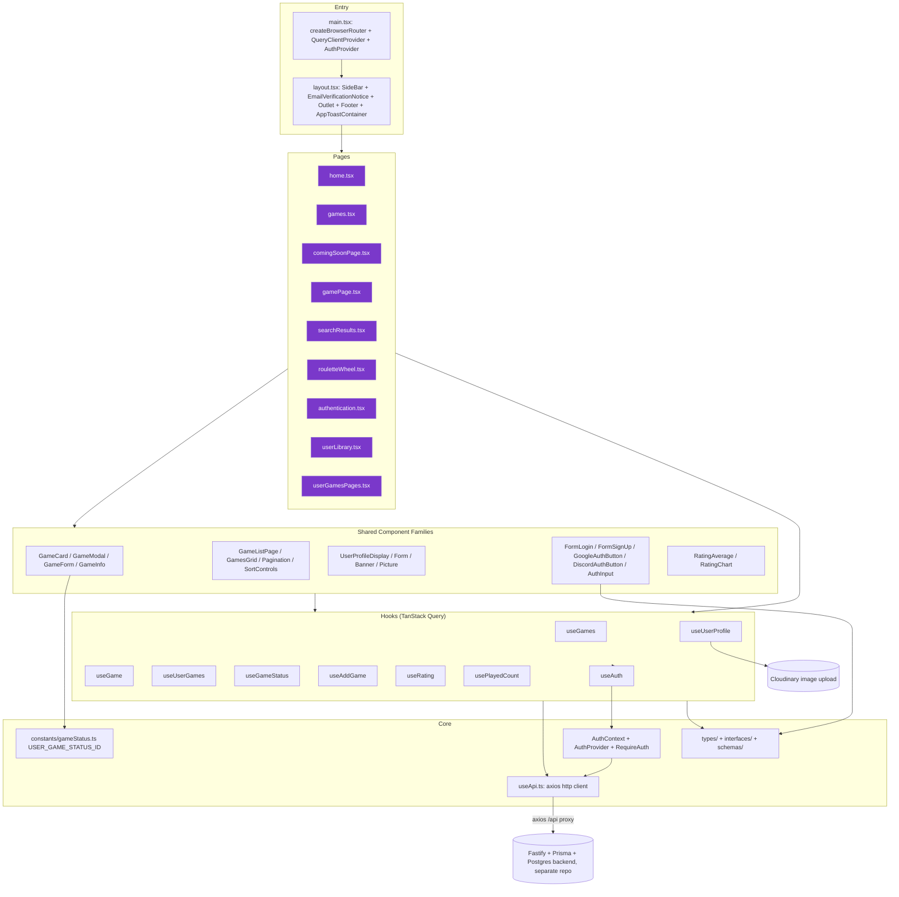

# Codebase Map

> Auto-generated by Cartographer. Last mapped: 2026-09-12T18:18:19Z

## System Overview

React 18 + Vite + TypeScript + TailwindCSS SPA for "Lib" — personal game-library tracker, IGDB-backed catalog + per-user status/rating/completion tracking. Backend: separate Fastify+Prisma+Postgres repo (`lib`), reached via `/api` (Vite dev proxy → `localhost:3333`). State: TanStack Query v5 for all server state, React Context only for auth. Styling: Tailwind, custom dark-theme tokens, `tailwind-merge` for conditional classes. Forms: `react-hook-form` + `zod`. Routing: `react-router-dom` v7 (`^7.18.5`) `createBrowserRouter`. No test files anywhere.



## Directory Structure

```
src/
  assets/                    static images
  components/                shared UI components (flat)
    gamesComponents/          GameCard/GameModal/GameForm/GameInfo/GamesGrid family
    userGamesComponents/      profile edit + platform import family
    libraryComponents/        library/profile page: header, status shelves, empty state
    homeComponents/           home page: cover wall, logged-out hero, playing now, next up, summary
    aboutComponents/          /sobre: typed game name, feature showcase (samples), FAQ, game sheet, shared section/link classes
    contactComponents/        /contato: copy-address block, mailto topic rows, `SUPPORT_EMAIL` + `mailtoHref`
  constants/                 USER_GAME_STATUS_ID
  contexts/auth/             AuthContext, AuthProvider, RequireAuth
  contexts/gameModal/        GameModalProvider (the single game modal) + its context
  hooks/                     TanStack Query hooks + useApi (axios client)
  interfaces/                component prop types (games/ui/user)
  pages/                     one file per route
  schemas/                   zod schemas (login/signup/profile)
  types/                     domain types (games/user/rating/sidebar)
  utils/                     helpers; `gamePath.ts` builds every game link and parses the `:gameRef` param; `platformConsoles.ts` mirrors the back end console × platform map; `releaseDate.ts` formats IGDB release dates in UTC (IGDB sends midnight UTC, local formatting shows the previous day in Brazil); `platformLabel.ts` shortens platform names (PC, PS5, Xbox Series...)
docs/                        this map
```

## Full Routing Map

All routes are children of one `<Layout/>` (persistent `SideBar` + `AppToastContainer`, via `<Outlet/>`).

| Path | Component | File | Auth-gated? |
|---|---|---|---|
| `/auth` | `Authentication` | `pages/authentication.tsx` | No |
| `/verify-email` | `VerifyEmailPage` | `pages/verifyEmailPage.tsx` | No (works logged in or out; consumes `?token=`) |
| `/confirm-email-change` | `ConfirmEmailChangePage` | `pages/confirmEmailChangePage.tsx` | No (the link in the mail sent to the new address; consumes `?token=`) |
| `/` | `Home` | `pages/home.tsx` | No (renders differently if logged in) |
| `/search/:query` | `SearchResults` | `pages/searchResults.tsx` | No |
| `/games` | `Games` | `pages/games.tsx` | No |
| `/games/comingSoon` | `ComingSoonPage` | `pages/comingSoonPage.tsx` | No |
| `/games/:gameRef` | `GamePage` | `pages/gamePage.tsx` | No (interactive parts hidden if logged out). `:gameRef` is a slug (`/games/the-witcher-3-wild-hunt`) or a numeric id (`/games/1942`, old links); see Non-obvious behaviour. `/games/:gameRef/reviews` is `GameReviewsPage`. |
| `/roulette` | `RouletteWheel` | `pages/rouletteWheel.tsx` | No (but needs `user.id` internally — see Gotchas) |
| `/termos` | `TermsPage` | `pages/termsPage.tsx` | No (linked from the footer "O projeto" column and from the sign-up checkbox label) |
| `/privacidade` | `PrivacyPage` | `pages/privacyPage.tsx` | No (same) |
| `/sobre` | `AboutPage` | `pages/aboutPage.tsx` | No (same; own layout, `components/aboutComponents/`) |
| `/contato` | `ContactPage` | `pages/contactPage.tsx` | No (same; own layout, `components/contactComponents/`) |
| `/userLibrary` | `UserLibrary` | `pages/userLibrary.tsx` | **Yes** (`RequireAuth`) |
| `/userLibrary/:status` | `UserGamesPageByStatus` | `pages/userGamesPages.tsx` | **Yes** (`RequireAuth`) |

## Module Guide

### Game card / modal / form family (`src/components/gamesComponents/`)

Core reusable "show a game, let a user act on it" unit.

| File | Role |
|---|---|
| `gameCard.tsx` | Cover thumbnail, 6 sizes (`small`/`medium`/`compact`/`larger` plus `row` 44px and `feature` 92px, both 7:10 and without badges or hover overlay). Exports `GameCard` + `getGameTag()` helper (also used standalone by `dlcAndOriginalGameArea.tsx`). `CATEGORY_TAGS` (IGDB category id → PT label) + `TEXT_HINTS` (regex fallback via name/summary when category id missing). Badges are two joined capsules, so they cannot overlap: top-right one capsule with the replay count (`RotateCcw` + `N×`, from `utils/cardBadges.ts` `replayBadgeCount`, which returns the whole label: `2×`, or `99+` with no second `×`) and the status icon, next to the tag in one flex row (`min-w-0 truncate`); bottom-left one capsule with rating, Infinito and platforms. The card is a `[container-type:inline-size]` and below 160 px the platforms collapse to one icon + `+N` (container variant `[@container(min-width:160px)]` on the icons after the first and on the two `+N` spans, inside one platform segment so the `*+*` divider selector, which ignores `display:none`, never draws a stray line). The badge segments keep `title` tooltips for mouse users (the layer is `aria-hidden`, the `sr-only` summary carries the same facts, including the tag). The whole badge layer is `aria-hidden`; the button name is the cover `alt` (just the game name) followed by an `sr-only` summary from `cardSummary` (`, Na fila, nota 4,5, zerado 2 vezes, Infinito, jogado em Steam`), and the hover name overlay is `aria-hidden`, so the name starts with the title and has no "banner" or repeated name. With `enableModal` the button calls `openGame(game, button)` from `useGameModal()` (the card no longer owns the modal) and carries `data-game-id`. `interactive` prop toggles `<button>` (default) vs plain `<div>` — exists solely so callers who already wrap the card in a router `<Link>` don't nest a button inside an anchor. |
| `gameModal.tsx` | Radix `Dialog` wrapper for game popovers; visually-hidden title for a11y. |
| `gameForm.tsx` | Status button row (Jogado/Jogando/Backlog/Lista de Desejos), filtered by whether `game.releaseDate` is past. Toggling active status removes it; different status updates; no status adds. Renders `PlayedCount` only when status is PLAYED. |
| `../gamePlatformsSection.tsx` | Platform rows in the game modal. Row key is `platform:console`; PlayStation/Xbox/Nintendo/Steam ask for the console through `ConsolePicker` (native `<select>`, options filtered by the game's IGDB platforms via `consolesForGame`; a single remaining console is added without asking), Epic adds as `UNKNOWN`. "Outro" is no longer offered (old `OTHER` rows still display). Row name is the console, or the platform when the console is `UNKNOWN`. Shows a note when a platform has 2+ known consoles (imports skip those games). |
| `../userGamesComponents/completionSuggestions.tsx` | `CompletionSuggestionsBlock`: expandable list under the import summary in the Steam card of the Importar jogos tab (`/configuracoes/importar`) (`fresh` toggle with amber dot, `last` outline button). Rows: cover/initials, hours vs time-to-beat, achievements, multiplayer warning (`lowConfidence`), "Marcar como Jogado" / "Ainda não terminei". Undo in the row and in a 10 s toast. `role="status"` region is always mounted. |
| `../userGamesComponents/hiddenImportRow.tsx` | Collapsed one-line row shown instead of the last import result when the user hid it (`Importação oculta · ● N para revisar · Mostrar`; count becomes a chip under 520 px). Count comes from the shared suggestions query. |
| `gameInfo.tsx` | Modal body: cover + name + `GameForm` + `RatingAverage` (or login prompt) + "Ver Detalhes"/"Cancelar". |
| `gamesGrid.tsx` | Grid wrapper, `GameCardData[]` → `GameCard` (`size="medium" enableModal`), falls back to `EmptyState`. |

Interconnection: `GameCard(enableModal=true)` owns local `open` state, lazily mounts `GameModal → GameInfo → (GameForm, RatingAverage)`. Every listing context that wraps `GameCard` in its own `<Link>` (home, search, similar games, game-list sections) passes `interactive={false}`.

### Auth flow

| File | Role |
|---|---|
| `contexts/auth/authContext.tsx` | `AuthContextType` (`user: Partial<User> \| null`, `loading`, `login`, `signup`, `logout`, `refreshUser`). |
| `contexts/auth/authProvider.tsx` | Hydrates `user` via `api.me()` on mount. Whole app tree gated behind `!loading`. `login`/`signup` call `api.me()` again after success, because those endpoints only return `{ id }` / `{ id, userName }` (no `email`, no `emailVerified`). `refreshUser()` re-fetches `/users/me` without touching `loading`, so it never unmounts the tree. |
| `contexts/gameModal/gameModalProvider.tsx` | The one game modal, mounted in `layout.tsx` around the page. Cards open it through `useGameModal()` (`hooks/useGameModal.ts`, which throws outside the provider); the provider holds the game snapshot, so the modal survives the card leaving a shelf after a status change. Closes when `pathname` changes, except for the canonical `replace` of `useCanonicalGameUrl`. On close it handles `onCloseAutoFocus` itself (the dialog has no `Dialog.Trigger`): focus goes to the card that opened it if it is still visible, else to the card of the same game (`[data-game-id]`, now in its new shelf) if visible, else to the page `h1`; after a close caused by navigation it restores nothing, so `useFocusOnRouteChange` wins. |
| `contexts/auth/requireAuth.tsx` | Redirects to `/auth`, stashes `location.pathname` in `sessionStorage['redirectAfterLogin']`. |
| `hooks/useAuth.ts` | `useContext(AuthContext)`, throws outside provider. |
| `formLogin.tsx` / `formSignUp.tsx` | react-hook-form + zod; read/clear `redirectAfterLogin` on success; render Google/Discord OAuth buttons. Use `useContext(AuthContext)` directly rather than `useAuth()` (inconsistent, functionally equivalent). |
| `emailVerificationNotice.tsx` | Strip rendered by `layout.tsx` under the nav on every page, only when `user.emailVerified === false` (OAuth accounts come verified). "Reenviar" + dismiss; dismissal is stored per user id in `sessionStorage['emailNoticeDismissed']`, so it returns next session. |
| `pages/verifyEmailPage.tsx` | Reads `?token=` once and strips it from the URL. Does **not** verify on load: it shows a "Confirmar e-mail" button and calls `api.verifyEmail` only on click, so link scanners in mail clients can't burn the single-use token (reloading before the click loses the token; reopening the email link works). Centered layout, display-font title. States: ready, success, invalid (400 or no token); "já está confirmado" only after a 400 for a verified session. The success copy names the session's email only if that session went from unverified to verified, since the link may belong to another account. Non-400 errors keep the button and show `getErrorMessage`. Logged in: `refreshUser()` then library link, or "Reenviar link" on an invalid link. Logged out: link to `/auth?tab=login`. |
| `googleAuthButton.tsx` / `discordAuthButton.tsx` | Full-page redirects to backend OAuth endpoints. Without props they are a plain `<a href>` (Login). With `acceptedTerms` the link carries `?acceptedTerms=true`; with `disabled` they render a `<button type="button" aria-disabled>` that ignores clicks and points to the checkbox message through `aria-describedby`. Both are thin wrappers over `oauthButton.tsx`. |
| `useApi.ts` (`api.login/signup/logout/me`) | axios instance, `withCredentials: true`, 401 interceptor clears cookies on `session_expired`/`unauthorized`. |

### Custom hooks (`src/hooks/`)

| Hook | Purpose | Query keys | Notes |
|---|---|---|---|
| `invalidateGameLists.ts` | Not a hook — `invalidateGameLists(queryClient)` invalidates the catalog lists only: `games`, `gameSearch`, `comingSoon`, `gamesFeatured`, `similarGames`. It does not touch `userGames` or `userProfile`; callers invalidate those themselves. Called by `useGameStatus`, `useRating`, `usePlayedCount` and `useHoursPlayed` so the catalog lists reflect a status/rating change. | n/a | Add a new list query key to `GAME_LIST_QUERY_KEYS` there. |
| `useGameRef.ts` | Turns the `:gameRef` route param (slug or id) into the numeric id string the other hooks use; resolves a slug through `GET /games/slug/:slug`. | `['gameBySlug', slug]` (also seeds `['game', id]`) | Returns `igdbId`, `isNotFound`, `isResolving`, `isFailed`, `refetch`. |
| `useCanonicalGameUrl.ts` | Replaces the address with `/games/<slug>[/reviews]` once the detail has a slug; exports `isCanonicalNavigation` for the scroll and focus effects. | n/a | See Non-obvious behaviour. |
| `useApi.ts` | Not a hook — exports `api` (axios wrapper), also called directly by `sideBar.tsx`/`rouletteWheel.tsx`, bypassing hook layer. | n/a | Sort-field mapping gotcha, see below. |
| `useGames.ts` | Catalog: paged, infinite (search), coming-soon, home-featured. | `['games',...]`, `['gamesInfinite',...]`, `['comingSoon',...]`, `['gamesFeatured']` (home: trending, most rated, recent releases; the counts come from the backend) | `keepPreviousData` on paging/sort. |
| `useGamePlatforms.ts` | Per-game platform rows (`platform` + `console`, one row per console). `addPlatform/updatePlatform/removePlatform` take `(platform, console, ...)` and hit `/users/platforms/:igdbId/:platform/:console`; the response replaces the cache. | `['gamePlatforms', userId, igdbId]` | `PUT` with a known console adopts an existing `UNKNOWN` row of the same platform (no new row). Console × platform map mirrors the back end in `utils/platformConsoles.ts`. |
| `useCompletionSuggestions.ts` | "Looks finished" suggestions per import platform (Steam only today). Query + accept/dismiss/undo; accepted rows are kept in local state because the back end drops the game from the list once it becomes Played, so Undo only lives while the screen is open. Accept/undo invalidate library, profile and per-game caches. | `['completionSuggestions', userId, platform]` | Invalidated by `refreshAfterImport`. 409 becomes an inline row message. |
| `useHiddenImportResult.ts` | Hides the last import result and the suggestions block until the next import finishes. Stores the import's `finishedAt` in `localStorage` (`importHidden:v1:{userId}:{platform}`) via `useSyncExternalStore`; falls back to memory when storage fails and notifies same-tab listeners itself (the `storage` event only reaches other tabs). | n/a | A new import changes `finishedAt`, so the result shows again. Browser-only, not synced. |
| `useGame.ts` | Single game + similar games. | `['game', igdbId]`, `['similarGames', igdbId]` | |
| `useGameStatus.ts` | Get/update one game's status. | `['gamesStatus', userId, igdbId]` | Invalidates `gameStats`, `userGames`. |
| `useAddGame.ts` | Add/remove from library. `removeGame` vs `removeUserGame` are near-duplicate mutations differing only in which cache they patch (`['games']` vs `['userGames', userId]`). | invalidates `games`, `userGames`, `gamesStatus`, `rating` | Optimistic + rollback. |
| `useRating.ts` | User rating, community average, distribution. | `['rating', userId, igdbId]`, average key embeds the rating value itself, `['ratings', igdbId]` | Optimistic + rollback. |
| `usePlayedCount.ts` | "Times completed" counter, enabled only when status id === 1 (hardcoded literal, not `USER_GAME_STATUS_ID.PLAYED`). | `['gameStats', userId, igdbId]` | Clamped min 1. |
| `useUserGames.ts` | Library grouped by status + totals + one recommended game. | `['userGames', userId, ...]`, `['games', userId]` | Key-prefix overlaps `useGames`'s `['games', ...]`, distinguished only by arg shape. |
| `useUserProfile.ts` | Profile fetch/update incl. Cloudinary upload. | `['userProfile', userId]` | Two-phase mutation: upload file(s), then submit URL string. |
| `useResendVerification.ts` | `{ resend, isSending, secondsLeft, waitLabel }` for `POST /auth/resend-verification`. Success toast + 60 s cooldown; a 429 starts a cooldown from `retry-after`; errors go through `getErrorMessage`. | n/a | The in-flight flag is module-level and the cooldown lives in `sessionStorage['emailVerificationResendCooldown']` as `{ userId, availableAt }`; a window event keeps the notice and the page in sync, so two buttons never send twice. |
| `usePrefersReducedMotion.ts` | `matchMedia('(prefers-reduced-motion: reduce)').matches`, read once per render — not reactive to live OS changes. | n/a | Feeds embla-carousel autoplay config. |

### Design tokens (`tailwind.config.js`)

```js
colors: {
  primary: { DEFAULT: '#7A38CA', light: '#9D52E8', hover: '#8B47DB', 'hover-light': '#AE63F9' },
  dark: { bg: '#1A1C26', 'bg-light': '#1F2029', 'bg-lighter': '#25262F', 'bg-darker': '#0F1117', card: '#181920', border: '#2A2B36' }
}
```

Custom screens: `wide` is `min-width: 1792px` (a plain width, so `wide:` works); `nesthub` and `asus` are plugin variants (`addVariant`, short viewports; unused in `src`), declared as plugins and not as `raw` screens because a `raw` screen turns off every `min-*`/`max-*` variant (see the note on `min-*` / `max-*` under Keyboard focus). Restart Vite after editing `tailwind.config.js`.

Convention: components use `bg-dark-bg*`, `border-dark-border`, `text-primary(-light)`, `bg-primary`, `hover:bg-primary-hover` — no hardcoded hex in `className`, except where third-party libs need literal color values (MUI `Rating` `sx` in `ratingAverage.tsx`) and in `rouletteWheel.tsx` (least-polished page, ad-hoc hex + placeholder text — known, deliberately unfinished per project owner).

### Everything else

| File | Purpose |
|---|---|
| `authInput.tsx` | Password-visibility-toggling input, `forwardRef` for RHF. |
| `button.tsx` | Variant/size system (primary/secondary/ghost/danger; secondary is the outlined style, danger is `red-700` for destructive confirms), loading spinner, `max-sm:min-h-11` touch height. |
| `iconButton.tsx` | The only icon-button component: `size` sm (28px) / md (36px), `tone` neutral/danger, `variant` filled/bare; a `before:` pseudo-element extends the touch area to 44px. |
| `categoriesDiv.tsx` | Pill chip — named for IGDB "category" but `gamePage.tsx` actually feeds it genre strings. |
| `details.tsx` | Genres/developers/publishers chips on game page. |
| `dlcAndOriginalGameArea.tsx` | Parent-game link + paginated DLC list, reuses `getGameTag`. |
| `emptyState.tsx` | Generic empty-state message. |
| `gameLaunchersDiv.tsx` | Per-platform release-date pill. |
| `gameMediaGallery.tsx` | Trailer and screenshot strips (Embla) plus the trailer dialog and the screenshot lightbox. Each strip is one Tab stop (roving `tabindex`): ArrowLeft/Right, Home and End move between thumbnails, focus uses `preventScroll` and the strip calls the Embla API's `scrollTo` (a native scroll would shift the `overflow-hidden` wrapper out of sync with Embla's transform). `gamePage.tsx` passes `key={game.igdbId}` so the Tab stop resets on a new game. The lightbox and the trailer dialog read `activeScreenshot`/`activeVideo` (derived, `undefined` when the index is out of range) instead of indexing the list while rendering, and an effect clears an index that falls outside a list that shrank. |
| `gameListPage.tsx` | Composes `SortControls`+`GamesGrid`+`Pagination`; manages URL query params via manual `URL`/`history.pushState` (not `useSearchParams`, unlike `authentication.tsx`). |
| `gameListSection.tsx` | Home page's 3 list sections: from `lg` one `FeaturedGameRow` (first game) plus `GameRow`s (numbered for trending/rated), horizontal `CoverRow` below. `RatedScore` (in `homeComponents/gameListRows.tsx`) calls `useRating` per game (N+1 pattern). Release dates and platform labels come from `utils/releaseDate.ts` and `utils/platformLabel.ts`. |
| `footer.tsx` | Site footer rendered by `layout.tsx` on every page; account links depend on login state. |
| `homeComponents/` | Home blocks: `coverWall` (CSS-animated cover rows, logged out), `loggedOutHero`, `playingNow` (cover, name and hours; no status button or marker, the status changes on the game page), `nextUp` (backlog suggestion + queue; while the backend suggestion is loading it shows a same-size skeleton, because the library answers first and the pinned game would otherwise jump from the first queued game to the suggested one; "Outra sugestão" remounts the pair with a short fade, `animate-swap-in`, off under reduced motion, and not on first load), `librarySummary`, `coverRow` (Embla carousel of covers: drag-free, `containScroll: 'trimSnaps'`, prev/next arrows from `sm` that fade out at the ends; generic over `GameCardData` with an optional `renderMeta`), `styles` (shared title/link classes). |
| `iconButton.tsx` | Icon-only button base for pagination. |
| `pagination.tsx` | First/prev/next/last + "showing X of Y". |
| `platformDiv.tsx` | Platform pill, heuristic console-vs-PC icon by name substring. |
| `playedCount.tsx` | +/- "times completed" widget. |
| `playersInfo.tsx` | Per-status user counts + ratings count. |
| `ratingAverage.tsx` | Dual-layer MUI `Rating` (readonly + interactive hover) + remove button. |
| `ratingChart.tsx` | HTML/CSS histogram of 10 half-star bins; below 6 ratings it shows ten dashed ghost bars (decorative, `aria-hidden`) plus a "missing N ratings" message instead of the real bars; hover/focus readout from 6 up. |
| `ownRatingEntry.tsx` | The "Sua nota" box inside `ownReviewCard.tsx` (reviews page): `RatingAverage` stars for a signed-in user, disabled stars with "Entre para avaliar" when signed out. A released game rated while outside the library shows the hint that it will be added as Jogando. |
| `searchBar.tsx` | Route-synced search input (`/search/:query`), autofocus + cursor-to-end. |
| `sectionHeading.tsx` | Reusable heading, colored dot + optional icon. |
| `sideBar.tsx` | Desktop nav + mobile drawer; calls `api.logout()` directly rather than via `useAuth()`. |
| `similarGamesSlider.tsx` | Embla carousel of similar games. |
| `sorting.tsx` | Sort field/order + optional status filter (user-library only). |
| `libraryComponents/profileHeader.tsx` | Shared profile header for `/userLibrary` and the public profile: optional low banner, picture, name, facts line (followers/following open modals), `actions` slot. No banner strip when `bannerUrl` is empty. |
| `libraryComponents/libraryShelves.tsx` | The four status shelves in fixed order (Zerados, Jogando, Pendentes, Lista de desejos; PAUSED has none). Owns copy, 3/8 caps (8 shown only from `2xl`), "Ver todos" links and empty-state links. `readOnly` for other users' profiles. |
| `libraryComponents/statusShelf.tsx` | One shelf: header + covers. Covers only, no text under them; `featured` (Jogando) = larger covers. Empty shelf collapses to one line with the link inline after the text. Mobile is a snap row, `lg` a 6-column grid. |
| `libraryComponents/emptyLibrary.tsx` | Whole-library empty state: import vs. add one by one. |
| `pages/settingsPage.tsx` | `/configuracoes` (inside `RequireAuth`): layout with back link, h1 "Configurações", `components/settingsTabs.tsx` (a `<nav>` of `NavLink`s, one route per tab, `aria-current` on the active one, horizontal scroll on narrow screens) and an `<Outlet />`. Runs `usePlatformLinkResult()` so the Steam/Xbox login notice shows on any tab. Child routes: `perfil` (default, `pages/settings/profileTab.tsx`: `UserProfileForm` + the unsaved-changes `useBlocker` dialog "Descartar alterações?", which also fires when switching tab), `importar` (`importTab.tsx`: lead sentence + the Steam/PSN/Xbox sections, each platform name an `h2`) and `conta` (`accountTab.tsx`: `EmailSection` + `DeleteAccountSection`) and `seguranca` (`securityTab.tsx`: the Senha section). `/conta` and `/importar` are `RedirectKeepingSearch` routes (`utils/redirectTarget.ts`) to the new tabs, keeping `?steam=`/`?xbox=` (`<Navigate to={to+search+hash}>`), so the backend redirect needs no change. |
| `userProfileDisplay.tsx` | Fetches own profile/followers, renders `ProfileHeader` + followers/following modals; its single "Configurações" button links to `/configuracoes`. |
| `userProfileForm.tsx` | Profile form used by the Perfil tab (banner/avatar upload with preview, dirty tracking via `onDirtyChange`). The payload is built by `utils/profileUpdate.ts` (`buildProfileUpdate`: `userName` only when the typed name differs from the stored one). It stays on the page after saving: `useUserProfile`'s `onSuccess` now awaits the profile refetch before `onUpdateSuccess` clears the previews, so the old photo does not flash. Focus ring for label-wrapped file inputs: `focusRingWithin` in `styles/focus.ts`. |

## Data Flow — Viewing a Game and Marking Status

```mermaid
sequenceDiagram
    participant U as User
    participant GP as GamePage
    participant UG as useGame(igdbId)
    participant GF as GameForm
    participant UGS as useGameStatus(igdbId)
    participant UAG as useAddGame(igdbId)
    participant API as api (axios /api)
    participant BE as Backend (Fastify)
    participant QC as QueryClient cache

    U->>GP: navigate to /games/:igdbId
    GP->>UG: useGame(igdbId)
    UG->>API: api.getGame(igdbId)
    API->>BE: GET /games/:igdbId
    BE-->>API: { game, relatedGames }
    API-->>UG: GameResponse
    UG-->>GP: render game details

    GP->>GF: render <GameForm game/>
    GF->>UGS: useGameStatus(igdbId)
    UGS->>API: api.getGameStatus(igdbId)
    API->>BE: GET /users/gameStatus/:igdbId
    BE-->>UGS: { userGameStatus: { id, status } }

    U->>GF: click "Jogando" (statusId=3)
    alt no existing status
        GF->>UAG: addGame({statusIds: 3})
        UAG->>API: POST /users/games/:igdbId {statusId: 3}
        UAG->>QC: invalidate games, userGames, gamesStatus, rating
    else status already active
        GF->>UAG: removeGame()
        UAG->>QC: onMutate optimistic patch
        UAG->>API: DELETE /users/games/:igdbId
        UAG->>QC: invalidate related queries
    else different status active
        GF->>UGS: updateGameStatus({statusIds: 3})
        UGS->>API: PATCH /users/gameStatus/:igdbId {statusId: 3}
        UGS->>QC: invalidate gamesStatus, gameStats, userGames
    end

    QC-->>GF: refetch -> re-render active button (no success toast; only errors notify)
```

## Commands

| Script | What it runs |
|---|---|
| `npm run dev` / `serve` | Vite dev server / preview of the build. |
| `npm run build` | `tsc -b && vite build`: a type error fails the build. |
| `npm run typecheck` | `tsc -b`. The root `tsconfig.json` has `"files": []` and only references `tsconfig.app.json` and `tsconfig.node.json`, so a plain `tsc --noEmit -p .` checks nothing; `-b` is the one that does. |
| `npm run lint` / `lint:fix` | `biome lint src` / with `--write` (safe fixes only). |
| `npm run format` / `format:check` | `biome format --write src` / read-only. |
| `npm run check` / `check:fix` | `biome check src` (format + lint + import order) / with `--write`. |
| `npm run test` | `vitest run` (vitest 3, since the project is on Vite 5; vitest 4 needs Vite 6). `vitest.config.ts` is separate from `vite.config.ts` so tests do not load the CSP plugin. Tests live next to the code as `src/**/*.test.ts` (node environment, so only pure utilities are tested; there are no component tests). |
| `npm run verify` | `typecheck`, then `check`, then `test`; run before committing. Exits 0 with no errors and no warnings. |

The tests are pure code only (`utils/*.test.ts`, `schemas/*.test.ts`, `constants/messages.test.ts`); there are no component tests. Biome is the only linter and formatter; ESLint and its plugins were removed from `devDependencies` (they had no config), so an `eslint-disable` comment would do nothing.

## Conventions

- Zod schemas paired 1:1 with react-hook-form via `zodResolver`; form types via `z.infer<typeof schema>`.
- TanStack Query hooks named `use<Noun>`, expose `.mutateAsync` wrapped in plain functions rather than the raw mutation object.
- No hardcoded hex in Tailwind `className` outside third-party libs needing literal colors (MUI) and the known-unfinished `rouletteWheel.tsx`.
- `focus-visible:outline focus-visible:outline-2 focus-visible:outline-offset-2 focus-visible:outline-primary-light` on every interactive element.
- `rounded-full` pill badges for small metadata chips; small square dot (`size-1.5 bg-primary`) as section-heading marker.

## Gotchas

1. **Line endings are LF everywhere in `src/`.** `biome check --write` (commit `ece26e3`) converted the ~10 files that were CRLF; `git blame` on those files stops at that commit (`git blame -w --ignore-rev ece26e3`).
2. **`interactive` prop on `GameCard`** — prevents `<button>` nested in `<a>`; always paired with `interactive={false}` where the caller wraps the card in a `Link`.
3. **Sort-field name mismatch**: `/users/userGames` backend expects `gameName`/`dateRelease`; only `useApi.getUserGames` maps this via `USER_GAMES_SORT_BY_MAP`. `getGames`/`getComingSoon` pass sort fields through unmapped — different backend routes use different naming conventions.
4. **Two independent status vocabularies**: `GameStatusEnum` (string, order Played/Playing/Paused/Backlog/Wishlist) vs `USER_GAME_STATUS_ID` (numeric, PLAYED:1/PAUSED:2/PLAYING:3/BACKLOG:4/WISHLIST:5 — different internal order). No compile-time link; kept in sync only by matching English key names. `usePlayedCount.ts` hardcodes numeric literal `1` instead of `USER_GAME_STATUS_ID.PLAYED`.
5. **`CategoriesDiv`/`categoryName`** used for genres in `gamePage.tsx` despite the name implying IGDB category (DLC/expansion/etc.) — real category-id classification lives in `gameCard.tsx`'s `getGameTag()`.
6. **`removeGame` vs `removeUserGame`** (`useAddGame.ts`) — near-duplicate mutations, differ only in which cache they optimistically patch. Candidate for consolidation.
7. **`/roulette` not wrapped in `RequireAuth`** despite needing `user.id` internally — shows empty state instead of redirecting when logged out.
8. **`/forgotPasswordPage` link in `formLogin.tsx`** has no matching route — intentional placeholder for a not-yet-built feature (per project owner), not a bug to fix.
9. **Unused dependencies**: `@auth0/auth0-react`, `typescript-cookie` in `package.json`, no imports found in `src/`.
10. **`usePrefersReducedMotion`** reads `matchMedia` once per render, not reactive to live OS setting changes.
11. **`types/sidebar.ts`'s `MenuItem`** and `interfaces/ui.ts`'s `SideBarItemProps` are leftover types from a `SideBarItem` component that no longer exists (removed as dead code in a prior cleanup) — latent dead types, not caught by file-level orphan scans since the type files themselves are still imported elsewhere.
12. **Local variable names shadow their own type names** in destructured `useQuery` results (e.g. `const { data: GameResponse } = useQuery(...)`) across several hooks — stylistic, not a bug.
13. **`index.html`'s `<body class="bg-dark-bg-lighter">`** vs `Layout`'s root div `bg-dark-bg` — redundant double background declaration, harmless (Layout's div covers the body).
14. **`zod` stays on 3.x (3.25.76) with an open advisory** (GHSA-mrhx-c7xc-m3w5, fixed only from 4.6.6): memory exhaustion when validating oversized collections that have length limits. The app uses `zod` only in the 5 form schemas under `src/schemas/` through `zodResolver`, none of them uses `array`, `set`, `map` or `record`, and nothing parses API or URL data with it, so the issue is not reachable here. Moving to `zod` 4 is a major migration (schemas and `@hookform/resolvers`); revisit it if the app starts validating collections. The `vite` and `esbuild` advisories only affect the dev server; their fix is `vite` 8 (a major bump).
15. **Trailer dialog: arrow keys and Esc stop working once the video has focus.** `autoplay=1` moves focus into the cross-origin YouTube iframe (checked: `document.activeElement` is the `IFRAME`), so neither `useCarouselKeyboardNav` nor Radix's Esc handler receives the key. The "Fechar" button and the overlay still close it. It cannot be fixed from the page; the screenshot lightbox is not affected.
16. **Image upload to Cloudinary is unsigned.** `api.uploadFile` (`hooks/useApi.ts`) posts straight to Cloudinary's `image/upload` endpoint with the open `images_preset`, so anyone who knows the preset name can upload to the account. The back end's `UsersService.delete` removes a user's stored photo and banner, but it does not limit what gets uploaded. Plan: a back-end endpoint that signs the upload, then the front sends `api_key`, `timestamp`, `folder` and `signature`, and only after that is live the unsigned preset is turned off in the Cloudinary console (turning it off first breaks photo and banner uploads in Edit profile). Meanwhile the preset should be restricted in the console (formats, size, folder).

## Non-obvious behaviour

Reasons that used to live in code comments (the project keeps source files comment-free; lint directives such as `biome-ignore` and `@ts-expect-error` stay in place).

**Lists and library**
- `components/gameListPage.tsx`: an empty list with a total above zero is not a real empty state. It is a page past the total, or the previous response kept by `keepPreviousData` while the right page loads. Both show the skeleton, not the empty state.
- `components/libraryComponents/libraryShelves.tsx`: on a public profile each status list arrives cut, so the per-mark count (Agora / Sempre jogando) is only reliable when every in-progress game came (`totalOf('PLAYING') <= games.PLAYING.length`).
- `components/gamesComponents/libraryStats.tsx`: `MAX_PLATFORMS_IN_MODAL` caps the per-platform detail in the modal; above it the detail lives only on the game page.
- `components/gamesComponents/gameCard.tsx`: top-rated lists carry the community average (for example 3.6969…), while the user's own rating is an integer.
- `interfaces/games.ts` (`interactive`): false when the caller already wraps the card in a `<Link>` or another clickable element, to avoid a `<button>` inside an `<a>`.

**Status, completions and the modal**
- `components/gamesComponents/gameStatusButtons.tsx`: with 2+ platforms the app asks first, because the status is saved before the completion is added (the modal now stays open on a status change, so this is no longer about it closing). On the pick, the status is saved first and the +1 completion on the chosen row after it, so a failed status writes nothing and a retry (another row, or after Cancelar) never double counts or lands on the wrong row. If the platform write fails the game is already Jogado and the picker stays open; `completionPending` makes a later click on Jogado reopen the picker instead of the removal dialog until the write succeeds or "Só marcar" is used; the retry skips the status PATCH when the game is already Jogado (no second toast). The Jogado button stays disabled while the platforms query loads or has failed, so the picker cannot be skipped by a click before the list arrives. `useGamePlatforms.onChanged` also invalidates `gamePlatforms` so a refetch started by the status save cannot leave a stale count. This relies on the back end leaving completions alone for 2+ platforms (`markSinglePlatformCompleted` returns unless there is exactly one).
- `components/gamesComponents/gameStatusButtons.tsx` (Desejos): the back end's `moveToWishlist` deletes the rating, the platforms (with their hours and completions), the completion suggestions, `completions`/`hoursPlayed` and the completion date; the review stays. So moving a game that already has a status to Desejos asks first ("Mover para a lista de desejos?"), but only when there is something to lose: a platform, a rating, hours or completions. While any of those queries is loading, or failed, it asks anyway (a failed query returns `0`/`null` and would otherwise move without asking). The data hooks only run for a game already in the library (`activeStatus ? igdbId : undefined`). `useGameStatus` also invalidates `['ratings', igdbId]` and the `averageRating` query on a status change, because the same move deletes the rating.
- `constants/gameStatus.ts` (`REVIEW_STATUS_LABEL`): only the statuses that allow a review have a label on the card.
- `hooks/useReviewPermission.ts`: someone who already has a review can edit it in any situation; the rule only applies to creating. A game in the backlog counts as played when there are hours or completions recorded (history of people who replay).
- `components/reviewRequirement.tsx` (`variant`): `link` points to the status buttons of the page itself; `picker` chooses the status right there.
- `components/reviewEditor.tsx` (`locked`): the field stays visible and disabled (no focus, no cursor) and `describedBy` points to the text with the reason.
- `utils/endlessAvailability.ts`: in Jogando, Pausado and Largado the flag is editable. In Jogado the control shows locked, because the flag may have stayed on from before. In Na fila, Lista de desejos and unreleased games it makes no sense, so the control does not show.
- `components/endlessToggle.tsx` and `components/gamesComponents/endlessChip.tsx` (`disabledReason`): when present, the control is inactive and the reason replaces the description (toggle) or appears beside it (chip).
- `components/ownReviewCard.tsx`: `Button` is a function component and does not forward `ref`, so the ref lives on a wrapper.

**Platforms and consoles**
- `utils/platformConsoles.ts` mirrors `CONSOLES_BY_PLATFORM` of the back end (`lib/src/utils/platform-consoles.ts`). The back validates again, so a value outside the map only yields a 400.
  - The back also accepts PC under XBOX (Game Pass on PC); the interface does not offer it: a PC game is registered under Steam, Epic or Outro > PC.
  - Epic has only PC: nothing to choose, so it enters as UNKNOWN (the back accepts it in any ecosystem). Steam asks between PC and Steam Deck.
  - The consoles list is the ones the game shipped on (plus backward-compatible successors); `null` means no platform data and does not filter. If the filter leaves no console of the ecosystem (incomplete IGDB data), it falls back to the whole list so the user is never left without an option.
  - Is there a console left to choose? An UNKNOWN row never coexists with known consoles (the back completes it when adding one), so it is enough to look at the consoles still without a row.
  - "Steam · PC" is redundant: PC on PC stores shows only the store name. Game Pass on PC shows "PC" with the Xbox icon, because "PC" alone would not say where it comes from.
- `utils/libraryPlatforms.tsx`: "Outro" stays in `LIBRARY_PLATFORMS` only to display old records; nothing new is added to it.

**Import**
- Hours per platform: `UserGamePlatformEntry.accountHours` (`{ gamertag, hoursPlayed }[]`, only XBOX rows have it) holds each linked account's contribution; `hoursPlayed` is their sum. With 2+ accounts, `AccountHoursLine` (modal in `libraryStats.tsx`) and the row hint in `gamePlatformsSection.tsx` list "gamertag + hours" as plain text; with one account nothing extra is shown. Editing hours by hand on an XBOX row is still allowed, but the next Xbox import overwrites it, and the editor says so.
- `hoursPlayed: null` means "no hours recorded yet", not zero (the Xbox did not report time, as on old Xbox 360 titles, or the platform was added by hand, or the field was cleared; the front cannot tell these apart): the modal and the platform row say "sem horas registradas", the field placeholder is "—", and `TotalsStrip` shows "—" under that label when every row is `null`. A real `0` still reads "0 h". Every hours label goes through `utils/hours.ts`: `formatHours` writes pt-BR with one decimal ("62,5 h", non-breaking space) and is used by the totals, profile, "Jogando agora" and review cards; `formatHoursDetailed` (up to two decimals, the precision the back end stores) is used only in the per-account breakdown, so the parts add up to the stored total and the one-decimal total above them is just its rounding; `formatHoursOrNone` returns "sem horas registradas" for `null`.
- Xbox allows up to 2 linked accounts (`User.xboxAccounts: { id, gamertag }[]`, back end `MAX_XBOX_ACCOUNTS`). `PlatformImportSection` takes optional `accounts`, `maxAccounts` and `getAccountResults`: with `maxAccounts > 1` it lists each account with its own "Desconectar" (`DELETE /users/xbox/:accountId`, confirmed in `ConfirmDialog`), shows "Adicionar outra conta" until the limit, and renders one result row per gamertag (a failed account shows its error only there; an account whose hours lookup failed shows the back end's `warning` in amber, also when there is a single account). Steam and PSN leave these props out and keep the single "Desconectar". `usePlatformImport`'s `disconnect` takes an optional account id. The `?xbox=limit` link result shows the limit message. Disconnecting removes that account's hours from the games (back end recomputes the sums).
- `components/userGamesComponents/platformImportSection.tsx`: the hidden-result block stays mounted when hidden, because the accepted rows and the "Desfazer" live in the block's state.
- `hooks/useCompletionSuggestions.ts`: the back removes the game from the list on accept. The accepted rows stay in local state so "Desfazer" stays visible while the screen is open.
- `components/userGamesComponents/hiddenImportRow.tsx`: classes are written out in full because Tailwind does not see names built by interpolation. Without a suggestions platform the hook only returns the Steam cache, so the count is ignored (`platform ? suggestions.pendingCount : 0`).
- `hooks/useHiddenImportResult.ts`: a hidden result only holds for the import whose end time was stored; a new import changes `finishedAt` and the result shows again. The `storage` event only reaches other tabs; the current tab is told by the listeners.

**Account deletion** (`components/userGamesComponents/deleteAccount{Section,Dialog}.tsx`, `hooks/useDeleteAccount.ts`)
- `useDeleteAccount` navigates to `/` with `flushSync: true` before `clearSession()`: without it the `RequireAuth` of the page being left sees the user disappear first and redirects to `/auth`, so the person landed on the login page instead of the home.
- `components/confirmDialog.tsx` is shared by every destructive confirmation, the account dialog included (it passes the typed field as `children`, `confirmDisabled`, and swaps label/variant/handler for the 403). It focuses Cancelar on open (needed when `children` holds an input). Only with `lockWhileLoading` (the account dialog) it ignores close requests and disables Cancelar while `isLoading`; the others stay dismissable because the axios client has no timeout.
- The section is the last card of the Conta tab (`pages/settings/accountTab.tsx`), outside any `<form>`, so its button never submits one. The dialog asks to type the username (read from the profile query), or the e-mail when the account has no username; the comparison trims the typed text but is case-sensitive, and a failed attempt's error clears as soon as the text changes.
- The back end only accepts `DELETE /users` for a login of the last 10 minutes: older ones answer 403 `reauth_required` with a message, shown inside the dialog. Nothing is deleted and the request is not repeated after a new login.
- A 404 with a JSON `message` counts as success (the account is already gone; a bare proxy 404 does not), but a deleted account's cookies usually fail earlier with 401, because the back end revokes the sessions: that goes through the normal session-ended flow. The 401 interceptor is silenced (`setAccountDeletionInProgress`) from the moment the DELETE is sent, and the flag is cleared on a failed request, on login and on sign-up, so requests still in flight do not show "Sua sessão terminou" over "Sua conta foi excluída". Queries are cancelled, the app navigates to `/`, `clearSession()` empties the user and `queryClient.clear()` drops the cache. `api.logout()` is not used: it reloads the page.
- `/termos` and `/privacidade` (through `LegalPage`) hold the owner's plain-language texts (no lawyer review; personal portfolio project), dated 2026-10-25. They are linked from the footer and from the sign-up checkbox label. `/sobre` and `/contato` are linked from the footer only and have their own markup (see below). The Terms say the user declares being 18+, and the sign-up form now has a required, unchecked-by-default checkbox for it (self-declaration, not age verification). If the texts change what the app really does (analytics, ads, private profiles), update them.
- Terms acceptance (`components/formSignUp.tsx`, `pages/authentication.tsx`): `acceptedTerms` lives in the sign-up form (`signUpSchema`, `z.boolean().refine`, because `z.literal(true, { message })` does not show its message in zod 3.23) and travels `AuthContext.signup` -> `api.signup` -> body of `POST /auth/register`. The 400 comes as `error.acceptedTerms[0]` (the top-level `message` is the generic "Invalid input"), read in `authProvider.signup`. The Google/Discord buttons stay disabled until the box is checked, then carry `?acceptedTerms=true`; the Login tab sends no parameter. A new account without acceptance makes the back end redirect to `/auth?error=terms_required`: the page keeps the notice in state, switches to the sign-up tab in the same `setSearchParams` call that removes `error`, and shows no toast. The notice sits in an `aria-live` region that is always mounted and does not move focus, because `useFocusOnRouteChange` focuses `main` 400 ms after the route loads on pages without an `h1`. The notice is cleared when the tab becomes Login (an effect, so browser back/forward also clears it), except in the render where the error has just arrived.

**About and Contact pages**
- `pages/aboutPage.tsx` uses the full content width like the home (no max width; `lg:` grids 7fr/5fr and 5fr/7fr) and does not use `LegalPage`. Its `h1` is `sr-only` ("Sobre o EuZerei", `useFocusOnRouteChange` focuses it); the visible opening is `aboutComponents/typedGameName.tsx`, `aria-hidden`, the page's only motion. It types and erases the game names with one `setTimeout` per step, cleaned up on unmount. With `prefers-reduced-motion: reduce` (read once through `usePrefersReducedMotion`) it shows only the first name with a dot, no cursor and no timer. Below `md` the name line reserves two lines (`min-h-[2.16em]`) so the buttons do not jump when "Minecraft Dungeons." wraps.
- The hero buttons depend on `useAuth().user?.id`: logged out gets "Criar conta" (`/auth?tab=signUp`) and "Ver jogos"; logged in gets "Importar jogos" (a `<Link>` to `/configuracoes/importar`) and "Minha biblioteca". `usePlatformLinkResult()` also runs on this page, so a link result that lands on `/sobre` still shows its toast.
- The samples in `featureShowcase.tsx` are static and labeled "exemplo"; the hours strip is the real `TotalsStrip` with sample props. State chips and stars are `aria-hidden` with a `sr-only` text next to them. The four features sit in a 2x2 grid from `lg` (one row from `2xl`) and share rows through `grid-rows-subgrid`, so titles, texts and samples line up across cards. Responsive rules use viewport breakpoints (there is no side bar and no container-queries plugin).
- `pages/contactPage.tsx` has no form: the address is a visible `mailto` link plus "Escrever e-mail" and "Copiar endereço". Copy uses `navigator.clipboard.writeText`; when it is missing or rejects, the address text is selected and the message says to copy it by hand. The message lives in an `aria-live="polite"` paragraph and is cleared after 4 s. Each topic row is a `mailto` with a subject prefixed `[EuZerei]`, and its "Escrever" label carries a `sr-only` complement with the topic (WCAG 2.4.4). The address constant is `SUPPORT_EMAIL` in `contactComponents/supportEmail.ts`. From `lg` the page is two columns (7fr/5fr): address, tips and the sensitive-data warning on the left; topics and the "Antes de escrever" links (FAQ on `/sobre`, Terms, Privacy) on the right.

- `/termos` and `/privacidade` already got the same treatment as Sobre and Contato (`b52594a`): full width, side table of contents (`legalToc.tsx`) for the numbered sections, texts unchanged.

**Keyboard focus and lint directives**
- **`min-*` / `max-*` variants work, but only since 2026-11-15.** `tailwind.config.js` used to declare `nesthub` and `asus` as `raw` screens, and Tailwind 3 only generates `min-*`/`max-*` when every screen is a plain string, so every `max-sm:…` compiled to nothing (for example `Button`'s `max-sm:min-h-11` never applied). The two screens are now plugin variants (`addVariant('nesthub', …)`, `addVariant('asus', …)`; neither is used in `src` today) and `max-sm:` is live. Turning it on changed one thing at 390 px: `Button`, the link-buttons built with `buttonClasses`, the OAuth buttons, the `StatusLink` of the not-found pages and the sign-up terms row (`items-center` and `mt-0` there so the text and checkbox sit in the middle of its 44 px) are 44 px tall instead of 32–40 px; nothing changed at 1280 px (measured on 32 screens, 1243 elements, plus the not-found pages). **Restart `npm run dev` after editing `tailwind.config.js`**: the running dev server keeps serving the old CSS. The Configurações screens still write the phone rules as `[@media(max-width:639px)]:…`, which is equivalent and also works. Text fields use `text-sm [@media(max-width:639px)]:text-base` (16 px on phones, because iOS Safari zooms when it focuses a field under 16 px). The header search (`Buscar`) and the fields of other screens are still 14 px.
- `components/confirmDialog.tsx` returns focus to whatever had it when the dialog opened. The disconnect dialog of `platformImportSection.tsx` is opened from a menu item that no longer exists when the dialog closes, so the section passes `returnFocusTo={menuTriggerRef}` (a ref to the "⋯" button) and focus goes there instead of to `body`.
- `pages/authentication.tsx`: both `Tabs.Content` panels have `tabIndex={-1}`. Radix gives them `tabindex=0`, which put two invisible Tab stops before the form fields. The `tablist` keeps `tabindex=0` on purpose: it is Radix's roving group and hands focus to the active tab.
- `components/searchBar.tsx`: `justSubmittedRef` makes the URL-sync effect skip one run after a submit (the field was just cleared). It is only set when the submit will change `pathname` or `query`; searching the current term again changes neither, the effect would not run and the flag would stay set, leaving the field empty after going back to another search.
- `pages/gameReviewsPage.tsx`: `setPage` is a `useCallback` over `setSearchParams`. In react-router 6 `setSearchParams` changes identity whenever the search params change, so `setPage` is not stable; the clamp effect (`page > totalPages`) re-runs often but stays idempotent.
- `biome-ignore` comments carry a reason and stay in the code. Effects that list a value only as a trigger use the per-dependency form (`useExhaustiveDependencies(pathname)`); a hook with several diagnostics (`layout.tsx`) uses one whole-rule comment. In JSX the comment goes inside the opening tag, before the attribute whose line precedes the flagged one (Biome starts the diagnostic at the end of the previous attribute line), not above the element. Explicit `role="alert"`, `"status"`, `"img"` and `"search"` keep their `biome-ignore` for `useSemanticElements`.

**Routing, scroll and errors**
- `utils/getErrorMessage.ts` shows the server's reason for a rejected password (`error.password[0]` from sign-up and reset, `error.newPassword[0]` from the change-password form, only when the field error is an array). Any other 400 with the generic `Invalid input` falls back to the text of the screen, so before this a common password such as `password123` only said "Não foi possível salvar a senha".
- **Return after login:** `formLogin` and `formSignUp` read `redirectAfterLogin` *before* calling `auth.login` / `auth.signup`. `PostLoginRedirect` navigates and removes the item as soon as `user` is set, which happens before the call returns, so reading it afterwards always gave `/` and the saved page was lost (the "Entrar de novo" return of the Segurança tab depends on this).
- **Game URLs use the slug** (`/games/<slug>`, `/games/<slug>/reviews`). The back end gives every cached game a unique `slug` (`lib` `games_cache.slug`); a game not cached yet comes with `slug: null` and its link falls back to the id. Rules: (1) every link is built by `gamePath(game, { reviews, search, hash })` in `utils/gamePath.ts`, never by hand; (2) the route param is parsed once at the page edge: `useGameRef(param)` (`hooks/useGameRef.ts`) uses `parseGameRef` (`id` = `^[1-9]\d{0,9}$`, `slug` = letters, digits and single dashes, not only digits, up to 100 chars, lower-cased; anything else is `invalid` and shows "Jogo não encontrado") and returns the numeric id **as a string**, which is what goes down to `useGame`, `useReview`, `useCommunityReviews`, `ReviewSummary` and `OwnReviewCard`, so the cache keys (`['game', id]`, `useRating`, `useGameStatus`) are the ones their mutations invalidate. A slug is resolved with `GET /games/slug/:slug`, and the response is written to `['game', id]` so `useGame` does not fetch again; (3) `useCanonicalGameUrl(game, { reviews })` replaces the URL once the detail arrives and has a `slug` (`navigate(..., { replace: true, state: { canonical: true } })`, keeping `search` and `hash`, so `?page=` and `#biblioteca` survive). It only runs when the path differs, so a list and a detail that disagree cost one replace, not a loop. `layout.tsx` (scroll to top) and `useFocusOnRouteChange` ignore a navigation whose state is `canonical`. `/games/comingSoon` is a static route and wins over `:gameRef`; React Router matches case-insensitively, so a game whose slug is `comingsoon` would hit it (none exists; the back end does not reserve it). The back end must have the migration and `backfill:slugs` before this front is deployed.
- **Toasts go through `notify`** (`utils/notify.ts`), never `toast.*` directly; all texts live in `constants/messages.ts` (`SUCCESS_MESSAGES`, `ERROR_MESSAGES`, `INFO_MESSAGES`, with `cannot(action)` building "Não foi possível … Tente de novo."). Rules: no emoji, one short sentence with a period, and a success toast for every action that saves or removes something ("Status atualizado.", "Horas salvas.", "Data salva.", "Nota salva.", "Resenha salva.", "Jogo adicionado.", "Jogo removido.", "{Plataforma} conectada."), plus the ones whose effect is not visible (the rating that adds or promotes a game, the Xbox console, copied list, verification link, account deletion, password reset, profile, undoable "marcado como Jogado"). Errors have their own text ("Não foi possível … Tente de novo."). `notify.failure(error, fallback)` shows the server message when `getErrorMessage` finds a specific one, otherwise the fallback. `notify.*(content, { id })` updates a toast that is already visible instead of stacking (rating feedback, login error, invalid library section, page out of range, platform link result). Success and info use `role="status"`, errors `role="alert"`. `AppToastContainer` (`components/appToastContainer.tsx`): bottom center from 768 px up and top center below it (`useMediaQuery('(max-width: 767px)')`, where the game modal fills the screen and a bottom toast would cover its buttons; the container is remounted with a `key` when the position changes, and up to 480 px a rule in `index.css` gives it an 8 px margin), 5 s for every toast (the undo toast in `completionSuggestions.tsx` keeps its own 10 s), `limit` 5 (a low limit queues the next toast, and the 10 s undo toast would wait), pause on hover and on focus loss, a left stripe and icon by type, and a close button named "Fechar aviso". Library gotchas: a function `toastClassName` **replaces** the default classes, so the base `Toastify__toast…` classes are repeated in it; the stripe color needs `!` because `!border-dark-border` would win; a Tailwind arbitrary variant with `__` in the class name does not work (underscores become spaces), so the icon margin reset is plain CSS in `index.css`, scoped by the `app-toasts` class of the container. The OAuth error texts (`OAUTH_ERROR_MESSAGES`) are looked up with `hasOwnProperty`, because the `error` query param is user-controlled and `constructor` would otherwise hit `Object.prototype`. Server messages (`lib`) were not changed: they are already full sentences.
- **The game modal is one, outside the lists** (`contexts/gameModal/gameModalProvider.tsx`). It used to live inside each `GameCard`, so a status change that moved the card to another shelf (or out of a filtered list) unmounted the card and closed the modal on the library pages while it stayed open on `/games`. The modal only reads `igdbId`, `name`, `coverUrl`, `slug`, `summary`, `releaseDate` from its snapshot; status, rating and hours come from the query cache. `invalidateUserGames(queryClient, userId)` (`hooks/invalidateUserGames.ts`) invalidates `['userGames', userId]`, `['publicUserGames', userId]` and `['publicUserProfile', userId]`, so the shelves behind the open modal (and your own public profile, which reads other keys) update at once; use it instead of invalidating `userGames` by hand. Screen readers: Radix puts `aria-hidden="true"` on `#root` while a dialog is open, and the `ToastContainer` lives inside it, so `notify` repeats plain-text messages in `aria-live` regions appended to `body` (`#notify-live-polite`/`-assertive`, kept visible by the dialog's `aria-hidden` pass because of `aria-live`), only while the `.Toastify` container sits under an `aria-hidden="true"` ancestor (otherwise the toast is announced twice), and callers that already speak through their own `aria-live` region pass `announce: false` (`completionSuggestions.tsx`, `useCompletionSuggestions.ts`; a new caller that does both will be read twice). A toast `id` that is still in its exit animation is not verified to show a new toast with the same id. Status, hours and completion-date toasts use a fixed `id`, so quick changes update one toast instead of stacking. Not covered: a real screen reader was never run. `ConfirmDialog` remembers the element that was focused when it opened (`onOpenAutoFocus`) and refocuses it on close (`onCloseAutoFocus`), because a trigger-less Radix `Dialog` otherwise drops focus on `body` (seen after cancelling "Mover para a lista de desejos?").
- `utils/hours.ts`: `formatHours` (and the spoken form) shows up to two decimals at any size (`0,22 h`, `13,05 h`, `28,83 h`), the precision of the stored `Decimal(6,2)`. It used one decimal, so 13,05 h showed as `13,1 h` beside an input holding `13,05`, and 0,02 h as `0 h`; an intermediate version used one decimal from one hour up and still disagreed with the input. The unit is separated by a no-break space (U+00A0): paste it, not a normal space, when you edit the file (the test uses `NBSP`).
- **Card badge count rule** (`utils/cardBadges.ts`): the replay pill shows from 1× in Na fila, Jogando, Pausado and Larguei, from 2× in Jogado (the status already says 1), never in Desejos or without status, and `99+` above 99. It is `N×` with the number first, like `totalsGrid` and the platform row. Infinito follows the same rule (the backend refuses to add completions to an Infinito game, so it tops out at 1×). Before this the trophy badge was absolutely positioned (`right-[26px]/[30px]`) next to the status icon and overlapped it by 2 px and sat 4 px higher; never position two badges separately in the same corner.
- The app is on `react-router-dom` 7.18.5 and still imports from `react-router-dom` (the package is kept in v7, and `RouterProvider`/`createBrowserRouter` resolve from it), so the 50 imports did not change; the v6 `future` flags became the default and `main.tsx` has none. Redirect targets that come from the user go through `utils/safeRedirectPath.ts` (rejects `//` and `\`), which is what keeps a stored `redirectAfterLogin` from leaving the app. `sessionStorage` is per origin: the OAuth callback returns to `localhost`, so open the app on `localhost`, not `127.0.0.1`, when testing the redirect after login.
- `layout.tsx` and `pages/gameReviewsPage.tsx`: the router keeps the scroll when changing page. A new page starts at the top; back/forward (POP) and anchor links (`#biblioteca`) are left as they are. Coming from "Ver todas" at the bottom of the game page, the reviews page goes to the top, but on browser back the restored scroll stays.
- `pages/userProfilePage.tsx`: the back end answers 400 for an id that is not a UUID and 404 for a UUID that does not exist; both show the not-found screen.
- `hooks/useApi.ts` (`getUserGames`): `/users/userGames` uses different names from the rest of the app (`gameName`/`dateRelease` instead of `name`/`releaseDate`); the mapping happens here so the inconsistency does not leak into the rest of the front.
- `utils/releaseDate.ts`: IGDB sends the release date as UTC midnight; formatting in the local time zone shows the previous day in Brazil.
- Jogo com a marca Infinito (`endless`): o "Vezes zerado" e o "Já zerei antes" não aparecem (`libraryRecordFields.tsx`, `gamePlatformsSection.tsx`, prop `endless`). Jogado continua valendo e a data "Finalizado em" fica; a contagem é no máximo 1, definida pelo Jogado. Ao marcar Jogado com várias plataformas o seletor "Em qual plataforma você zerou?" só aparece se ainda não houver zerada (o backend exige pelo menos 1 conclusão em Jogado). Voltar para Jogando mantém contagem e data como histórico (troféu "Já zerado" no card).

## Navigation Guide

- **Add a new API endpoint**: add method to `hooks/useApi.ts` (`api` object) → wrap in a TanStack Query hook under `hooks/` → consume from a page/component.
- **Add a new page**: create under `src/pages/`, register route in `src/main.tsx`, wrap in `RequireAuth` if it needs a logged-in user.
- **Add a new component**: create under `src/components/` (or a `gamesComponents`/`userGamesComponents`/`libraryComponents` subfolder if it belongs to those families); use existing Tailwind color tokens (`primary`, `dark.*`), never hardcode hex; add `focus-visible` state if interactive.
- **Modify auth**: `contexts/auth/authContext.tsx` (shape) → `authProvider.tsx` (logic) → `requireAuth.tsx` (gating) → `hooks/useAuth.ts` (accessor).
- **Modify game status logic**: `constants/gameStatus.ts` (numeric ids) + `types/games.ts` (`GameStatusEnum`, string) — remember these are two separate vocabularies kept in sync by convention only (see Gotcha 4).
- **Add a new design token**: `tailwind.config.js` `theme.extend.colors` — reference the token elsewhere via `bg-<name>`/`text-<name>`/`border-<name>`, never inline the hex again.

- OAuth return (Steam/Xbox): the backend (`lib`: `steam.controller.ts`, `xbox.controller.ts`, commit `448094e`) redirects to `/importar?steam=`/`?xbox=`. `usePlatformLinkResult()` runs in `pages/settingsPage.tsx` and also on `/userLibrary` and `/sobre`. Deploy the front first and the backend after: a front without the `/importar` redirect would show a 404 for the return. The old `/importar` path now only redirects (keeping the query) to `/configuracoes/importar`; the hook runs in `pages/settingsPage.tsx`.
- `components/userGamesComponents/platformImportSection.tsx` (card layout): header with the platform icon tile (platform color only on the icon), `h2` name, status line, one primary action (Importar / Tentar novamente / Ver na biblioteca / sign-in) and a Radix `DropdownMenu` ("⋯") holding "Adicionar outra conta" (with `addAccountHint` as its description, disabled at the limit), "Ocultar até a próxima importação" and, last and red, "Desconectar <conta>" per account (opens the existing `ConfirmDialog`). The account list only renders with 2+ accounts or when an account has `extra` (Xbox console select); with one account it would just repeat the status line. On phones the primary action takes its own full-width row (`@media(max-width:480px)`). The generic description is shown only when not connected or with 2+ accounts. `ImportResultSummary` `last` variant is a line plus pills ("N jogos novos", "M sem correspondência") and a "Ver detalhes" toggle; failures use a tinted surface with an icon, not a left stripe.
- Settings page (`/configuracoes`): see the `pages/settingsPage.tsx` row. The old `/conta` page and `pages/accountPage.tsx` / `pages/importGamesPage.tsx` no longer exist; their content is the `conta`, `perfil` and `importar` tabs. Unsaved edits are guarded in `profileTab.tsx` with `useBlocker` (pathname change, including a tab switch, only while `useAuth().user` exists) plus a `beforeunload` listener. The Segurança tab also has the "Entrar com" section (below).

- Security tab (`pages/settings/securityTab.tsx`, route `/configuracoes/seguranca`): `PasswordSection` changes or sets the password through `api.changePassword` (`PUT /auth/password`, `hooks/useChangePassword.ts`). `User.hasPassword` (from `/users/me`) decides the form: with a password it asks for the current one (`schemas/changePasswordSchema.ts`, `makeChangePasswordSchema(hasPassword)`); without one (account created through Google/Discord) it only asks for the new password, and the server answers `403 reauth_required` if the last sign-in was more than 10 minutes ago, which shows the "Entre de novo" block (`hooks/useReauth.ts`: stores `redirectAfterLogin` explicitly, then `logout()` + `/auth?tab=login`; `utils/isReauthRequired.ts` is the shared 403 predicate, also used by `useDeleteAccount`). The success toast depends on `hadPassword` ("Senha alterada." / "Senha definida."). `SettingsTabs` has four tabs now: it scrolls the active tab into view and shows a right-edge fade only while the row actually overflows (ResizeObserver + scroll listener).

- E-mail change (Conta tab, `components/userGamesComponents/emailSection.tsx`, `hooks/useEmailChange.ts`, `schemas/changeEmailSchema.ts`): three states from `GET /users/me` (`pendingEmail`, treated as "nothing pending" when missing): the normal row with an "Alterar e-mail" button; the form (new e-mail, plus the current password when `hasPassword`; `makeChangeEmailSchema(hasPassword)`); and "Enviamos um link para …" with "Reenviar" and "Cancelar troca". The request goes to `POST /auth/email-change`; a 403 `reauth_required` (accounts without a password, last sign-in over 10 minutes ago) swaps the form for the "Entrar de novo" block (`useReauth('/configuracoes/conta')`). Server errors show in the form (wrong password, same address, address in use). The "Alterar e-mail" focus is restored when the form closes (the project `Button` does not forward refs, so the section keeps a ref on its wrapper `div`). `pages/confirmEmailChangePage.tsx` (`/confirm-email-change`) works like `verifyEmailPage`: reads `?token=` once, strips it from the URL and confirms only on a click (mail scanners prefetch links); on success it shows the new address, asks to sign in again (the back end revoked every session) and calls `refreshUser()`, which ends the stale session with the usual "Sua sessão terminou" notice; 400 means expired, used or cancelled, 409 means the address was taken meanwhile.

- Steam card note (`components/userGamesComponents/steamImportSection.tsx`, `connectedNote` prop of `PlatformImportSection`): one gray line, "Jogos do Modo Família só entram se você os jogou nas últimas 2 semanas.", shown while Steam is connected and not importing, between the result and the cooldown line. Only the Steam card passes it. The reason is on the back end: Steam's owned-games list leaves out Family Sharing games, and the import adds only those from the recently played list (last 2 weeks).

- Sign-in providers (Segurança tab, `components/userGamesComponents/providerSection.tsx`, `hooks/useProviderLink.ts`): `ProviderSection` shows one row per provider (Google, Discord) from `googleLinked`/`discordLinked` of `GET /users/me` (missing = not linked). **Vincular** calls `api.startProviderLink(provider)` (`POST /auth/<provider>/link`), checks that the returned URL is on the provider's origin (`accounts.google.com`, `discord.com`) and navigates the **same tab** to it (the login does the same); a 403 `reauth_required` shows the "Entrar de novo" block (`useReauth('/configuracoes/seguranca')`). **Desvincular** opens a `ConfirmDialog` (`lockWhileLoading`, `returnFocusTo` = the button, found through a wrapper `span` because `Button` does not forward refs: Safari and Firefox on macOS do not focus a button on click, so the default focus return would land on `body`) and calls `DELETE /auth/<provider>/link`. When the provider is the only way left to sign in (`hasPassword` + linked providers = 1) the button uses `aria-disabled` (not `disabled`, so it stays reachable by keyboard and its description is read) and its click does nothing; `aria-describedby` points to the explanation "Este é o seu único jeito de entrar. Defina uma senha antes de desvincular o …", and the server refuses it too (409). The way back from the provider is read by `SecurityTab`: `?vinculado=google|discord` shows "… vinculado." and refreshes the profile; `?vinculo_erro=<code>&provedor=<provider>` shows `providerLinkErrorMessage` (`ja_ligado_outra_conta`, `ja_ligado`, `email_nao_verificado`, `negado`, `sessao`, anything else = generic); only `google`/`discord` are accepted as providers (anything else gives the generic wording), `negado` is shown as an info notice and not as an error, the parameters are removed from the URL and the toasts carry an `id` so React Strict Mode does not show them twice. `useProviderLink` resets the pending link on `pageshow` with `persisted` (coming back from the provider by the Back button restores the page from the back/forward cache with the spinner still on). The copy does not promise that an unlinked provider can no longer be used to sign in (the back end re-links it by verified e-mail; see the back end map).

## Card de jogo 100% (moldura holográfica)

- `GameCardData.hundredPercent` (vem do backend, `user_games.hundred_percent`). `GameCard` só mostra a marca com `status === 'PLAYED'` e fora dos tamanhos `small`/`row`/`feature`: moldura `.hundred-frame` (`src/index.css`, gradiente iridescente que gira devagar; parada em `prefers-reduced-motion`), diamante (Gem) no lugar do ícone de status e sem a faixa de status do topo (para não formar borda dupla). `cardSummary` acrescenta "concluído a 100%" ao nome acessível.
- Interruptor "Concluído a 100%" (`components/hundredPercentToggle.tsx`, `hooks/useHundredPercent.ts`, `PUT /users/hundred-percent/:igdbId`) em "Editar registro", só para jogo Jogado.

## Animação ao fim da importação (faíscas + contagem)

- Em `platformImportSection.tsx`, quando a importação termina com sucesso (depois do mínimo de 1,5 s), `finishImport` liga `celebrating` por `IMPORT_FINISH_MS` (0,9 s), esmaece o bloco por `IMPORT_LEAVE_MS` (0,5 s, `leaving`) e o resultado entra com fade e subida de 8 px em 0,6 s (`animate-import-result`); a contagem dura 1,1 s e só então `showImportResult`: o componente `importFinishBurst.tsx` mostra a barra cheia soltando faíscas (sem anel nem visto: duas animações bastam, com a contagem dos números) (CSS em `src/index.css`, classes `import-*`). Em seguida o resultado entra e `useCountUp` faz os números subirem (só na variante `fresh`; o valor final fica num `sr-only` e o número que roda é `aria-hidden`, para o `<output>` não anunciar cada passo).
- Falha não anima. Com `prefers-reduced-motion: reduce` não há celebração nem contagem: a barra completa e o resultado troca no lugar. Vale para Steam, PlayStation e Xbox (mesmo card).

## Modal de excluir conta (A1)

- `DeleteAccountDialog` recebe `summary` (jogos, seguidores, seguindo, contas vinculadas, vindos de `useUserProfile` em `DeleteAccountSection`) e mostra quatro itens com ícone e número. Resenhas e curtidas ficam sem número (o perfil não traz essa contagem; precisaria de campo novo no backend). O campo ganha borda e visto verdes quando o texto confere (continua ignorando espaços nas pontas).
- `ConfirmDialog` ganhou `titleIcon` (ícone vermelho antes do título) e `wide` (440 px); os outros usos não mudam.
- Não feito: aviso de "entrar de novo" ao abrir o modal (hoje só vem do 403 `reauth_required` depois de confirmar; saber antes pede um dado do backend).

## Mensagens da importação (`constants/importMessages.ts`)

- Cada faixa de progresso tem 4 a 5 frases, a fila tem 5, e os avisos de espera (20 s e 90 s) têm 3 variações. A ordem é sorteada por importação (`messageSeedRef` em `platformImportSection.tsx`, semente nova a cada início) com um embaralhamento determinístico (`shuffled`), então as frases não se repetem até acabarem as da faixa, e trocam a cada 6 s. Frases neutras de plataforma (sem "console" nem "troféu"). Testes em `importMessages.test.ts`.

## Desvincular Google/Discord pede a senha

- `ProviderSection` passa `needsPassword` (`hasPassword` e o outro provedor não está ligado); então o diálogo de desvincular mostra o campo de senha, o botão só liga com algo digitado, e a senha vai em `DELETE /auth/:provider/link` (`api.unlinkProvider(provider, currentPassword)`). O erro (por exemplo "A senha atual está incorreta.") aparece no próprio diálogo, que só fecha quando dá certo.

## Jogos favoritos (faixa no perfil, até 4)

- `FavoriteGamesSection` (`components/libraryComponents/favoriteGamesSection.tsx`) entra entre o cabeçalho e as prateleiras em `/userLibrary` (`editable`) e em `/users/:userId` (só leitura). Dados: `useFavoriteGames(userId, paused)` (`GET /users/:userId/favorites`, chave `['favoriteGames', userId]`; `paused` desliga o refetch enquanto a pessoa edita, para não mudar o rascunho por baixo); salvar: `useSaveFavorites` (`PUT /users/favorites` com a lista inteira em ordem, grava a resposta no cache). `invalidateUserGames` também invalida `['favoriteGames', userId]`. **Qualquer jogo do catálogo pode ser favorito**, esteja ou não na biblioteca (jogo fora dela vem sem `status`).
- Visitante sem favoritos: a seção não aparece. Dono sem favoritos: convite "Escolha até 4 jogos favoritos". Erro ao carregar: o dono vê "Tentar novamente" e **não** consegue editar (evita salvar por cima da lista real); o visitante não vê nada. Na faixa, o botão "Editar" (secundário, com lápis) fica ao lado do título e o `GameCard` usa `enableModal`.
- Edição no lugar: "Editar" troca a faixa por 4 vagas (`favoriteSlots.tsx`). Vaga vazia ou "Trocar jogo" abre `favoriteGamePicker.tsx` (Radix Dialog): sem texto mostra os jogos que já estão na seção (subir, descer, tirar); com 2 letras ou mais busca em **todos os jogos** (`api.searchGames`, 12 resultados, com atraso de 250 ms; os já escolhidos aparecem apagados).
- Arrastar é **próprio**, por eventos de ponteiro (sem dependência): o cartão sai do lugar e acompanha o mouse (cópia levantada, inclinada, com sombra, num portal), a vaga de destino mostra "Soltar aqui" e os outros cartões deslizam para abrir espaço (animação FLIP de 180 ms, desligada em movimento reduzido). A regra é `moveFavorite` (empurra os outros) em `utils/favorites.ts`. O estado do arrasto fica numa referência síncrona (o "soltar" pode chegar antes de o React renderizar). Só mouse e caneta; no toque valem as setas ◀ ▶ (e as da lista do modal), que sempre empurram uma casa. Esc cancela o arrasto; perder o foco da janela também.
- Salvar fica desligado sem mudança (compara o rascunho com o layout salvo, inclusive vagas vazias); Cancelar descarta; `UnsavedChangesGuard` (`components/unsavedChangesGuard.tsx`, também usado em `profileTab.tsx`) pede confirmação ao sair com edição pendente. Ao salvar, vagas vazias do meio sobem (`compactFavorites`). `<output>` anuncia a nova posição. No celular as vagas viram 2×2 com botões de 44 px.
- **Coroa (jogo favorito entre os favoritos):** no máximo um jogo da seção tem a coroa (`isMain` vindo do servidor; `PUT /users/favorites` leva `{ igdbIds, mainIgdbId }`). Na edição cada vaga tem um botão de coroa (`Crown` do lucide, `aria-pressed`, `data-no-drag`, 44 px no celular; roxo quando ativo): clicar passa a coroa, clicar de novo tira, e tirar ou trocar o jogo da vaga tira a coroa (`clearMainIfRemoved`, `toggleMain` em `utils/favorites.ts`; `isFavoritesDirty` também compara a coroa). O número da vaga foi para a legenda ("1 · Hades II").
- **Marcas visuais** (`favoriteCardMarks.tsx`, estilos `.favorite-*` em `src/index.css`): anel roxo afastado 6 px do cartão + selo simples de coroa no centro do topo + **onda de luz** (faixa diagonal a cada 3,6 s, defasada por vaga) para cartões coroados e/ou 100% **só dentro da seção de favoritos**. Cor por estado: roxa no favorito comum; holográfica no 100% (anel e selo ficam holográficos e **estáticos** se o jogo é coroado e 100%, e a moldura interna sai: `GameCard favorite` aplica `.hundred-frame` só quando `!favorite`, e mantém o diamante e o texto "concluído a 100%"). `isHundredPercent(game)` (`utils/cardBadges.ts`) é o único predicado de "100%" (`hundredPercent && status === 'PLAYED'`), usado no `GameCard` e nas marcas. O `[container-type:inline-size]` do cartão vale para todo cartão que não é `bare` (as regras `@container` das plataformas dependem dele, mesmo com `hoverEffects={false}`). Movimento reduzido: sem onda e sem animação do anel. `cardSummary` acrescenta "favorito" ao nome acessível, e a mudança de coroa é anunciada por `<output>`.
- `GameCard` ganhou `hoverEffects`, `statusBar` e `favorite` (todos com padrão que não muda os outros usos).
- Atenção ao verificar tipos no front: o `tsconfig.json` raiz só tem referências; `npx tsc --noEmit` não checa nada. Usar `npm run typecheck` (`tsc -b`).
